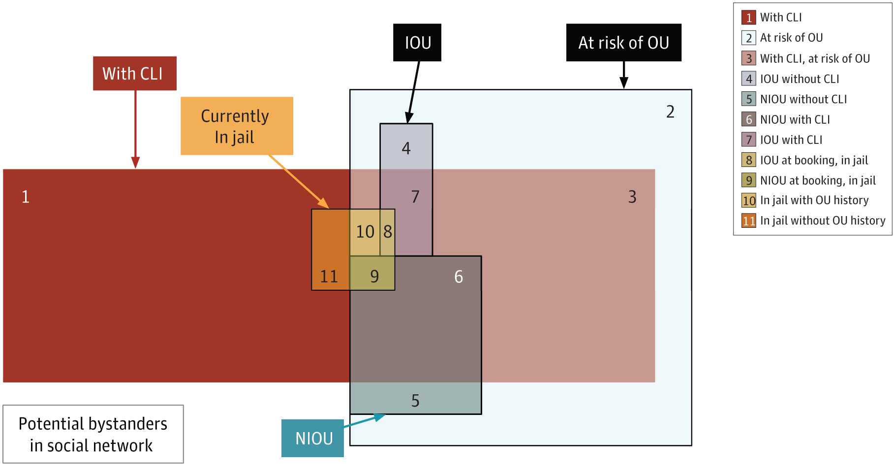
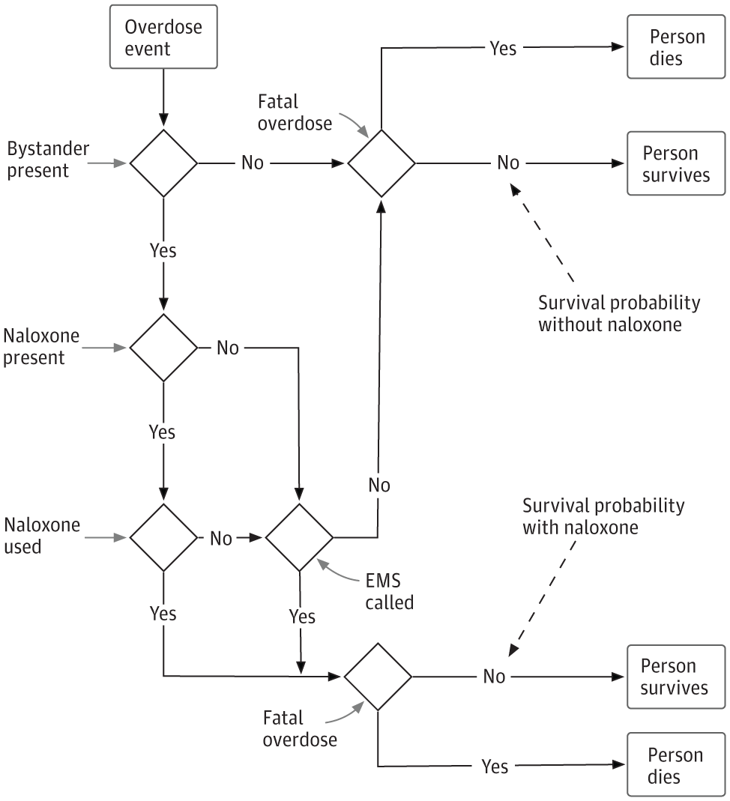

[](https://doi.org/10.5281/zenodo.24407242)

# Code and Data Supplement to *Impact of jail-based MOUD administration on post-release overdose mortality: an agent-based modeling study*

This document provides an overview of the Justice Community Circulation Model (JCCM) code, data, and analysis as a supplement to the manuscript *Impact of jail-based MOUD administration on post-release overdose mortality: an agent-based modeling study*.

>[!TIP]
>Instructions on reproducing the manuscript results are included in [REPRODUCING.md](REPRODUCING.md).

## Contents

- [Model overview](#model-overview)
- [Code overview](#code-overview)
- [Repository layout](#repository-layout)
- [Requirements](#requirements)
- [Installation](#installation)
- [Running the model](#running-the-model)
- [Parameters and scenarios](#parameters-and-scenarios)
- [Model output](#model-output)
- [Parameter sweeps with Swift/T](#parameter-sweeps-with-swiftt)
- [Output analysis](#output-analysis)


## Model overview
Detailed description of JCCM methods and sources of data were previously described in:

>[!NOTE]
>Tatara E, Ozik J, Pollack HA, et al. ***Agent-Based Model of Combined Community- and Jail-Based Take-Home Naloxone Distribution**. JAMA Netw Open. 2024;7(12):e2448732. https://doi.org/10.1001/jamanetworkopen.2024.48732

The Justice Community Circulation Model (JCCM) is an agent-based model of opioid use disorder (OUD), opioid overdose, and the movement of people between the community and jail. The model is used to evaluate jail-based interventions for people with OUD: medications for opioid use disorder (MOUD) provided during incarceration, linkage to MOUD care after release, and naloxone distribution at release.

JCCM is written in Python using [Repast for Python (repast4py)](https://repast.github.io/repast4py.site/). Parameter sweeps are run on HPC clusters with [EMEWS](https://emews.org) workflows built on [Swift/T](http://swift-lang.org/Swift-T/).

The JCCM seeks to capture nuanced dynamics by incorporating location-specific data on population demographics, drug use, and risk behaviors along the opioid-treatment cascade of care. By scrutinizing these local parameters, the JCCM complements other implementation science perspectives, allowing the systematic investigation of internal program factors and contextual barriers and facilitators that may affect the interventions’ population impact and cost-effectiveness. Additionally, the JCCM represents a person’s perspective as they experience events, such as jail release or naloxone administration, along with their time- and location-dependent opioid-related overdose risks. 

The JCCM models a synthetic population of persons with and without criminal-legal-system involvement (CLI) and persons with and without illicit opioid use. The synthetic population aimed to capture local dynamics of persons with current or past opioid use and the locale’s total population with CLI, many of whom have not used opioids. Persons who use and are at risk of using illicit opioids were modeled as autonomous agents. Each possessed unique demographic characteristics and time-varying states (eg, drug use and CLI). These variables were combined with risk-effect variables that together had implications for the probability of experiencing and surviving opioid-related overdose.



### Modeling Take-Home Naloxone to Individuals at Jail Release 
Modeled interventions included 3 complementary Take-Home Naloxone (THN) kit distribution channels: (1) community clinics, pharmacies, harm reduction practitioners, and OUD treatment facilities; (2) jail, which gives THN kits directly to persons with a history of opioid use at their release; and (3) social network or peers of persons released from incarceration. The JCCM does not explicitly model social networks, but it modeles the probability that a released person has at least 1 peer with a THN kit when opioid-related overdose occurs.

THN is effective only when a bystander is present, willing, and able to intervene. We varied the probability of bystander presence from 30% to 90% The following figure shows the possible sequence of JCCM events following overdose events. Bystanders are not explicitly modeled as agents; however, potential bystander actions during otherwise-fatal opioid-related overdoses were posited to alter survival probability. Without a bystander, the survival probability for the person is modeled by the fatality probability per overdose. When a bystander is present and willing to intervene, the bystander may choose to call emergency medical services (EMS) and administer naloxone if available. The bystander logic separately considers the probability of naloxone availability at the overdose location and the probability that it is actually or effectively used.



## Code overview
### Synthetic population

The population is generated at the start of each run from demographic fractions by gender, race/ethnicity (non-Hispanic White, Black, Hispanic, Other), and age group (18–24, 25–34, 35–44, 45+).

- **Criminal justice–involved (CJI) population** of size `cji.all.size`. The fractions `cji.fraction.pwid` and `cji.fraction.nihu` of this population are assigned to the PWID and NIHU states. The remainder have no OUD (`Non_OUD`).
- **Community populations** of people who inject drugs (PWID, `pwid.population.size`) and people with non-injection heroin use (NIHU, `nihu.population.size`) who are not involved in the justice system. These are included only when `cji.only` is `False`.

A person's OUD state does not change during a run. Agents who die are replaced by agents with the same demographic attributes and initial OUD state, which keeps the population size constant.

### Overdose risk

People in the NIHU and PWID states may overdose on any day they are in the community. People do not overdose while incarcerated. The daily overdose probability is a base probability multiplied by effects for:

- gender and age group;
- time since release from jail (weeks 0–2, weeks 3–4, week 5 onward), applied only to people whose most recent jail stay exceeded `cji.overdose.tolerance.days` and who therefore have reduced opioid tolerance;
- MOUD, applied as the multiplier `moud.od.risk` while a person has a therapeutic level of medication.

Base probabilities and multipliers are read from `data/state_transition_effects.csv` and can be overridden in the parameter file (see [Transition probability overrides](#transition-probability-overrides)).

### Overdose outcomes

1. A bystander is present with probability `probability.bystander`.
2. When a bystander is present, naloxone is available if the person holds a naloxone kit, if a member of their social network received a kit, or with probability `naloxone.level.community` (community distribution). Available naloxone is administered with probability `probability.naloxone.administer` and reverses the overdose with probability `probability.naloxone.reversal`.
3. Also when a bystander is present, emergency medical services (EMS) are called with probability `probability.ems`. Survival with EMS response uses the same reversal probability.
4. Without naloxone or EMS, the overdose is fatal with the `Overdose → Death` base probability.

A person who survives an overdose returns to their prior state. When bystander naloxone reverses an overdose that would otherwise have been fatal, the model records a death averted.

### Jail

- The jail starts with `cji.jail.initial.size` people drawn at random from the CJI population.
- With `cji.jail.daily.intake: -1`, daily arrests replace released people so that the jail population stays at its initial size. A positive value admits a fixed number of people each day. Arrests are drawn at random from CJI people in the community. A selected person who is taking MOUD is arrested with probability `moud.rearrest.risk`.
- Length of stay is drawn from three categories with probabilities `jail.loi.fractions`: short (1–2 days), medium (3–10 days), and long (11 days or more, Weibull-distributed).
- People are screened for OUD after `jail.oud.screen.wait.time.days`. OUD is detected with probability `jail.oud.screen.probability`. The screen produces no false positives.
- When the jail offers MOUD (`jail.moud.type` other than `None`), people with detected OUD are offered that medication after `jail.moud.wait.time.days` and accept with probability `jail.moud.acceptance.rate`. People already taking MOUD when arrested continue it in jail. Screening and MOUD initiation occur only when they fall before the release date.
- Naloxone kits held by a person are removed at arrest.

The available medications are methadone, sublingual buprenorphine, extended-release buprenorphine, and extended-release naltrexone.

### Release

- People taking MOUD at release continue treatment for a duration drawn from the medication-specific time-on-treatment distribution in `data/moud_time_on_treatment.csv`, sampled uniformly within each histogram bin. The duration is multiplied by `moud.linkage.to.care.multiplier`, with a minimum of 1 day. The protective effect of MOUD lasts `moud.therapeutic.days.after.last.dose.<medication>` days after treatment stops.
- People with OUD receive a naloxone kit at release with probability `naloxone.level.jail`. A member of their social network receives a kit with probability `naloxone.level.jail.network`. A kit used in a non-fatal overdose is replaced when `naloxone.refill` is `True`.

Social networks are not represented explicitly. Naloxone held by a person's network is a person-level attribute.

## Repository layout

| Path | Contents |
|---|---|
| `jccm_model/` | Python package containing the model |
| `data/` | Scenario parameter files (`model_props_*.yaml`), model input data (CSV), and scripts used to prepare and check input data |
| `swift_proj/` | EMEWS / Swift/T workflow for parameter sweeps, and the sweep input files used in project experiments |
| `analysis/` | R scripts for generating sweep inputs and analyzing model output. `analysis/archive/` holds older scripts kept for reference. |
| `set_model_path.sh` | Adds the repository root to `PYTHONPATH` when sourced from the repository root |

## Requirements

**Model**

- Linux or macOS. On Windows, use the Windows Subsystem for Linux (WSL).
- Python 3.9–3.13 (the versions supported by repast4py). The model has been run with Python 3.10 and 3.11.
- An MPI implementation, such as OpenMPI or MPICH, including the `mpicxx` compiler wrapper. repast4py and mpi4py are compiled against it during installation.
- Python packages: `repast4py`, `pandas`, `pyarrow`, `pyyaml`. Installing repast4py also installs `numpy`, `mpi4py`, `numba`, `networkx`, and `torch`.

**Parameter sweeps and analysis (optional)**

- [Swift/T](http://swift-lang.org/Swift-T/) built with Python and R support.
- R 4.x. The post-run script called by the sweep workflow requires `data.table`. Reading Parquet output in R requires `arrow`. The sweep-generation and analysis scripts also use `jsonlite`, `tidyverse`, `ggplot2`, `patchwork`, `viridis`, `ggridges`, and `forestploter`.

## Installation

1. Install MPI and a C/C++ compiler. On Ubuntu or Debian:

   ```bash
   sudo apt install build-essential openmpi-bin libopenmpi-dev
   ```

2. Clone the repository and create a Python virtual environment:

   ```bash
   git clone https://github.com/UChicago-CCHE-Modeling/JCCM_MOUD_Jails_Manuscript_Supplement.git
   python3 -m venv ~/venvs/jccm
   source ~/venvs/jccm/bin/activate
   ```

3. Install the Python packages:

   ```bash
   pip install --upgrade pip
   env CC=mpicxx CXX=mpicxx pip install repast4py
   pip install pandas pyarrow pyyaml
   ```

   After a change of MPI version, a cached repast4py build can cause conflicts. In that case reinstall with `env CC=mpicxx CXX=mpicxx pip install repast4py --force-reinstall --no-cache-dir`. To use a development version of repast4py, run `env CC=mpicxx CXX=mpicxx pip install -e .` from the root of a local repast4py clone.

4. JCCM is run from the repository and is not installed with pip. Add the repository root to `PYTHONPATH`:

   ```bash
   cd JCCM
   export PYTHONPATH=$(pwd)     # equivalent to: source set_model_path.sh
   python3 -c "import jccm_model"
   ```

## Running the model

Run the model from a working directory below the repository root, not from the root itself. Output is written relative to the working directory. The `local_proj/` directory is ignored by git and can be used for local runs:

```bash
mkdir -p local_proj && cd local_proj
python3 -m jccm_model ../data/model_props_methadone.yaml
```

The first argument is a scenario parameter file. Input files named in it are resolved relative to the directory that contains the parameter file. An optional second argument is a JSON string that overrides any parameter:

```bash
python3 -m jccm_model ../data/model_props_methadone.yaml '{"stop.at": 455, "random.seed": 7}'
```

The default scenarios simulate 1,915 days (a 90-day burn-in followed by five years) for a CJI population of 50,000. One such run takes about 3 minutes and 600 MB of memory on a desktop computer. At the end of a run the model prints the total deaths, overdoses, deaths averted, and EMS calls after the burn-in period. A run shorter than `burnin.period.days` therefore reports zeros.

### Running from Python

```python
from mpi4py import MPI
import jccm_model

jccm_model.run(MPI.COMM_WORLD, "../data/model_props_methadone.yaml", '{"stop.at": 365}')
print(jccm_model.get())   # "Done." after a completed run
```

The Swift/T workflow uses the return value of `jccm_model.get()` to detect completed runs.

### Note on MPI/Parallelism
- A single simulation runs on one process. Launching the model with `mpirun -n N` starts N copies of the same simulation, which write to the same output directory. Use the Swift/T workflow to run many simulations in parallel.

## Parameters and scenarios

### Scenario files

All scenario files are in `data/`. They share the same parameter values except as listed.

| File | Scenario |
|---|---|
| `model_props_none.yaml` | Baseline: no MOUD in jail, no naloxone distribution |
| `model_props_methadone.yaml` | Methadone offered in jail |
| `model_props_slbup.yaml` | Sublingual buprenorphine offered in jail |
| `model_props_xrbup.yaml` | Extended-release buprenorphine offered in jail |
| `model_props_xrntx.yaml` | Extended-release naltrexone offered in jail |
| `model_props_naloxone.yaml` | Naloxone distribution at release and in the community, no MOUD. Includes the community PWID and NIHU populations (`cji.only: False`) and simulates 455 days. |

### Main parameters

Default values are those in `model_props_methadone.yaml`.

| Parameter | Default | Description |
|---|---|---|
| `stop.at` | 1915 | Last simulated day |
| `burnin.period.days` | 90 | Days excluded from the end-of-run summary |
| `random.seed` | 42 | Random number seed |
| `cji.only` | True | Simulate only the CJI population |
| `cji.all.size` | 50000 | Size of the CJI population |
| `cji.fraction.pwid`, `cji.fraction.nihu` | 0.035, 0.1 | Fractions of the CJI population in the PWID and NIHU states |
| `pwid.population.size`, `nihu.population.size` | 24000, 66000 | Community PWID and NIHU populations (used when `cji.only` is `False`) |
| `cji.jail.initial.size` | 6000 | Jail population size |
| `cji.jail.daily.intake` | -1 | Daily admissions; -1 holds the jail population constant |
| `jail.loi.fractions` | [0.25, 0.25, 0.50] | Probabilities of short, medium, and long stays |
| `cji.overdose.tolerance.days` | 7 | Stay length above which a person has reduced opioid tolerance at release |
| `jail.oud.screen.wait.time.days` | 1 | Days from admission to OUD screening |
| `jail.oud.screen.probability` | 1.0 | Probability that screening detects OUD |
| `jail.moud.type` | Methadone | `Methadone`, `Buprenorphine_Sublingual`, `Buprenorphine_XR`, `Naltrexone_XR`, or `None` |
| `jail.moud.wait.time.days` | 1 | Days from a positive screen to MOUD initiation |
| `jail.moud.acceptance.rate` | 1.0 | Probability of accepting MOUD when offered |
| `moud.therapeutic.days.after.last.dose.methadone` / `.slbup` / `.xrbup` / `.xrntx` | 1 / 1 / 90 / 30 | Days of protection after the last dose |
| `moud.od.risk` | 0.2 | Overdose risk multiplier while MOUD is at a therapeutic level |
| `moud.rearrest.risk` | 1.0 | Arrest probability for a selected person who is taking MOUD |
| `moud.linkage.to.care.multiplier` | 1.0 | Multiplier on post-release time on treatment |
| `probability.bystander` | 0.60 | Probability that a bystander is present at an overdose |
| `probability.naloxone.administer` | 0.70 | Probability that available naloxone is administered |
| `probability.naloxone.reversal` | 0.95 | Probability that naloxone or EMS reverses an overdose |
| `probability.ems` | 0.50 | Probability that a bystander calls EMS |
| `naloxone.level.jail` | 0.0 | Probability that a person with OUD receives naloxone at release |
| `naloxone.level.jail.network` | 0.0 | Probability that the person's social network receives naloxone at release |
| `naloxone.level.community` | 0.0 | Probability that a bystander has naloxone from community distribution |
| `naloxone.refill` | True | Replace a kit after use |
| `output.directory` | output | Output directory, relative to the working directory |
| `output.file.format` | csv | `csv` or `parquet` |

### Transition probability overrides

Parameters named `transition_FROM*TO*ATTRIBUTE` override entries in the transition table `data/state_transition_effects.csv`. Attributes that refer to a person characteristic use the form `Enum.value`:

```yaml
transition_NIHU*Overdose*Base_Probability: 0.0007
transition_PWID*Overdose*Gender.Female: 0.6
transition_PWID*Overdose*Jail_Release.Week_0_2: 6
transition_Overdose*Death*Base_Probability: 0.085
```

The prefix `transition_OU` sets the NIHU and PWID overdose values together. It is accepted for `Base_Probability`, `Gender.Female`, `Jail_Release.Week_0_2`, `Jail_Release.Week_3_4`, `Jail_Release.Week_5`, `Age.25-34`, and `Age.35-44`. The `Age.35-44` value is also applied to `Age.45+`. For `Overdose → Death`, only `Base_Probability` is used.

### Input data

| File | Contents |
|---|---|
| `state_transition_effects.csv` | Daily overdose base probabilities and multipliers by state, and the overdose fatality probability |
| `cji_group_fractions.csv` | Demographic composition of the CJI population |
| `pwid_group_fractions.csv` | Demographic composition of the PWID population |
| `nihu_group_fractions_kelley.csv` | Demographic composition of the NIHU population (`nihu_group_fractions_broz.csv` is an alternative estimate) |
| `moud_time_on_treatment.csv` | Time-on-treatment histograms by medication. Sources are listed in the `citation` column. |

## Model output

Each run writes the following files to `output.directory`:

| File | Contents |
|---|---|
| `events.csv` | One row per event, with columns `tick`, `event`, `person`, `message` |
| `stats.csv` | One row per day: counts of deaths, overdoses, jail admissions and releases, deaths averted, and EMS calls; jail population; and the number of people in each OUD state |
| `initial_persons.csv` | The generated synthetic population |
| `model_props.yaml` | All parameter values used in the run, including overrides |

With `output.file.format: parquet`, the events and initial population are written as Parquet files. `stats.csv` is always written as CSV.

Event types in `events.csv`:

| Event | Meaning (`message` contents) |
|---|---|
| `overdose` | Overdose (`Fatal` or `Non-fatal`) |
| `death` | Death |
| `death_averted` | Bystander naloxone reversed an overdose that would otherwise have been fatal |
| `ems_called` | EMS called during an overdose |
| `administer_treatment` | Naloxone administered |
| `enroll_treament` | Naloxone kit received (`Naloxone_Jail`, `Naloxone_Jail_Network`, or `Naloxone` for a refill) |
| `jail_intake`, `jail_release` | Jail admission and release |
| `jail_oud_screen` | OUD screening result (`True` or `False`) |
| `jail_start_moud`, `jail_no_start_moud` | MOUD offer accepted or declined in jail (medication name) |
| `jail_continue_moud` | MOUD continued in jail by a person arrested while on treatment |
| `moud_duration_draw` | Sampled post-release time on treatment (days) |
| `stop_moud` | Treatment stopped (days on treatment) |
| `moud_end_therapeutic_dose` | MOUD protection ended |
| `nonfatal_overdose_moud`, `fatal_overdose_moud` | Overdose while on MOUD (days on treatment) |
| `transition` | OUD state change |

## Parameter sweeps with Swift/T

Sweeps are defined by an unrolled parameter file (UPF). Each line of a UPF is a JSON object of parameter overrides and defines one model run:

```
{"run":1, "random.seed":1, "stop.at":180}
{"run":2, "random.seed":2, "stop.at":180}
```

`swift_proj/data/upf_small.txt` is a small test sweep. The UPFs in `swift_proj/data/moud/` and `swift_proj/data/naloxone/` were used in project experiments. New UPFs can be generated with `analysis/jccm_generate_sweep_upf.R`.

The workflow `swift_proj/swift/swift_run_sweep.swift` runs each line of the UPF as a separate model run through Swift/T's Python interface. After each run, it calls the R function `tabulate_run()` from `analysis/jccm_analyze_run_response.R` to write a one-row summary, `runs_response.csv`, into the run directory.

To launch a sweep, edit `swift_proj/swift/run_jccm_sweep.sh` and run it from `swift_proj/swift/` with an experiment name and a scenario file name (relative to `data/`):

```bash
cd swift_proj/swift
./run_jccm_sweep.sh my_experiment model_props_methadone.yaml
```

Results are written to `swift_proj/experiments/<experiment>/runs/run_<N>/`. If the experiment directory already exists, the script asks for confirmation before continuing. `analysis/jccm_combin_run_responses.R` combines the per-run summaries of an experiment.

## Output analysis

The R scripts in `analysis/` operate on sweep results. Input and output paths are set near the top of each script and must be edited before use.

| Script | Purpose |
|---|---|
| `jccm_generate_sweep_upf.R` | Generates UPF files for intervention and sensitivity sweeps |
| `jccm_analyze_run_response.R` | Per-run summary called by the sweep workflow |
| `jccm_combin_run_responses.R` | Combines the per-run summaries of an experiment into one table |
| `jccm_moud_analysis_linkage_to_care_plots.R` | MOUD linkage-to-care analysis and figures, using the combined table |


